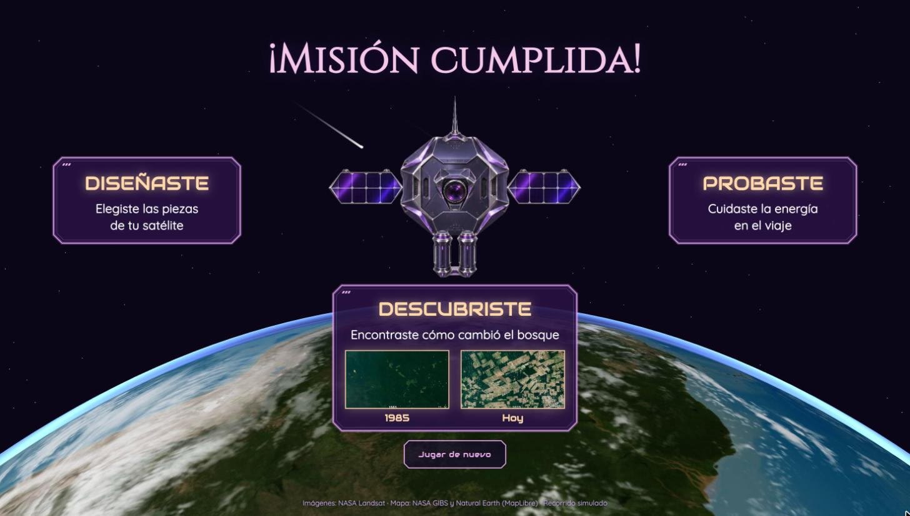
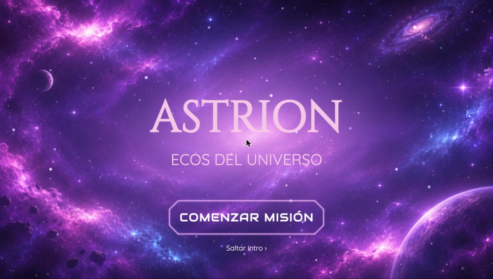
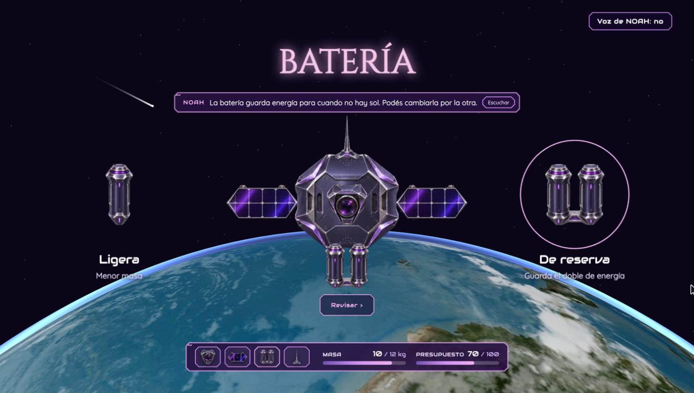
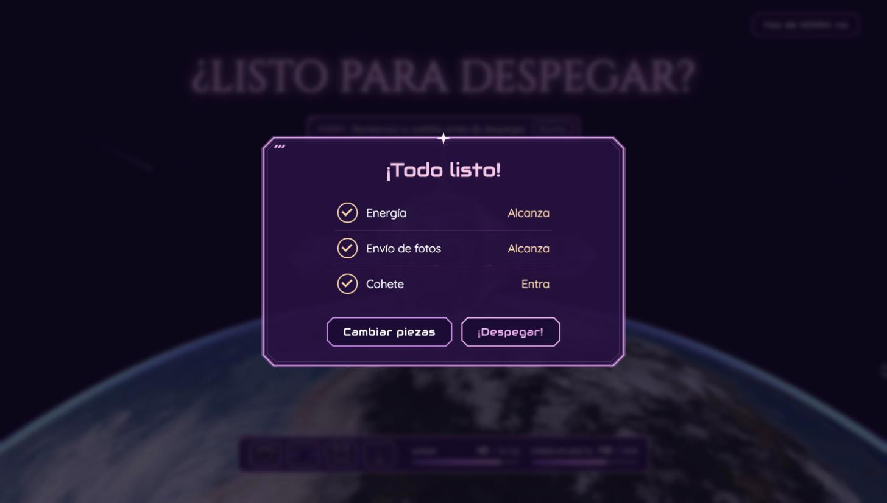
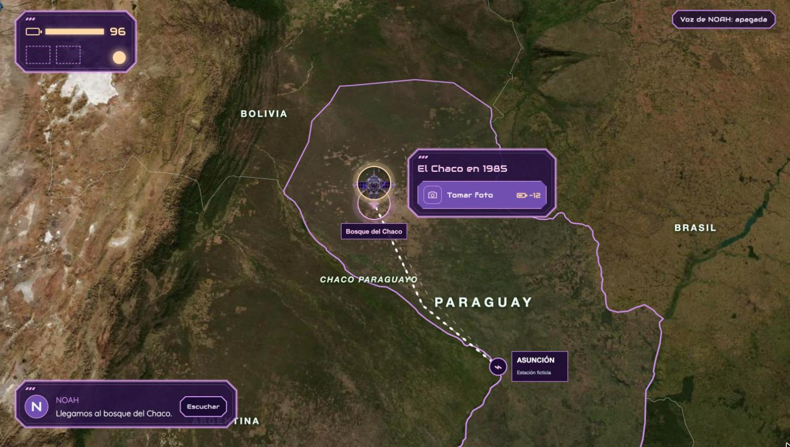
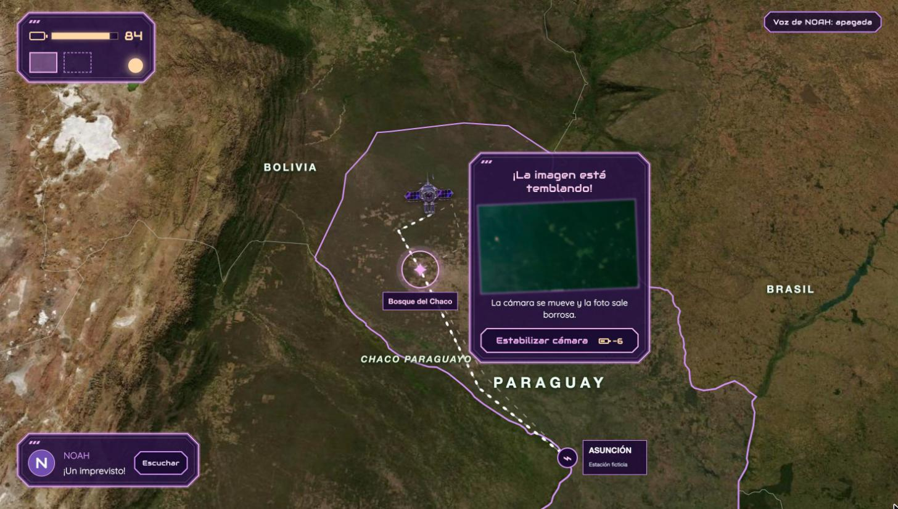
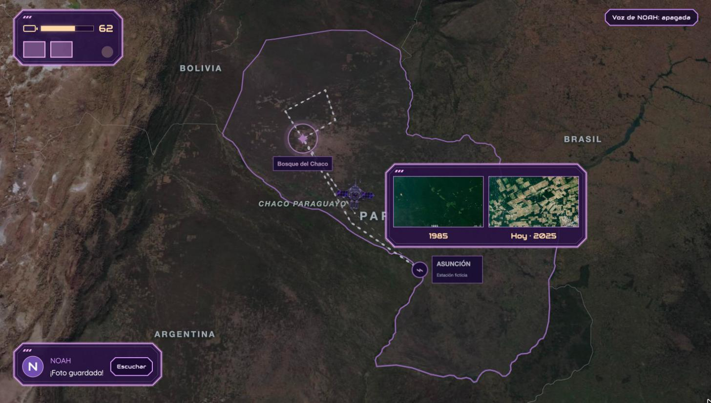
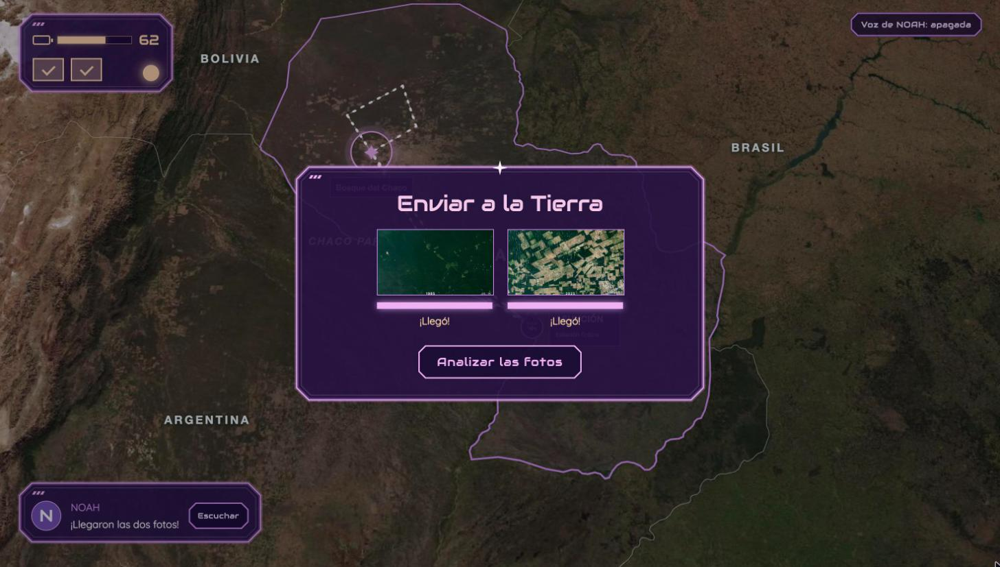
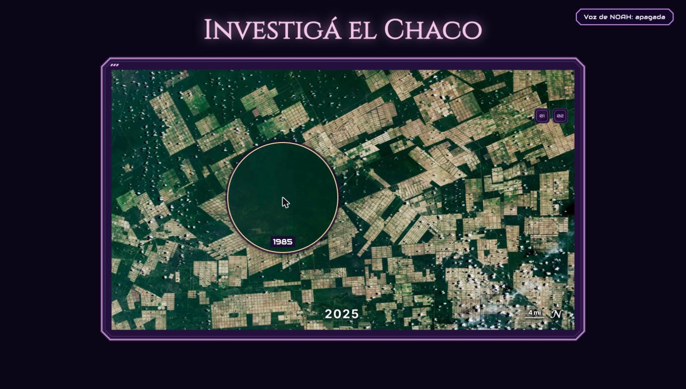

# ASTRION · Chaco Mission

**Design a satellite, fly it over Paraguay and use real NASA images to discover how the Chaco forest
changed in 40 years.**

An educational web game made for the **NASA Space Apps Challenge 2026**, challenge
[Space Mission Design Game](https://www.spaceappschallenge.org/2026/challenges/space-mission-design-game/).
Made for kids aged **9 to 12**. The game is in Spanish, with a voiced AI guide called NOAH.



## Screenshots

| | |
| --- | --- |
|  |  |
| Title screen | Building the satellite, part by part |
|  |  |
| Pre-flight check: energy, photo sending and rocket | Flying over Paraguay: the photo menu next to the satellite |
|  |  |
| A surprise problem: the camera is shaking | The two photos: the Chaco in 1985 and today |
|  |  |
| Sending the photos to the Asunción ground station | Investigating: the lens shows the same place in 1985 |

## The problem

Paraguay's Gran Chaco is one of the forests that has disappeared fastest in recent decades. NASA's Landsat
satellites have photographed it for more than 40 years, and comparing those photos makes the change
visible. ASTRION lets kids live that work: design the mission, fly it and discover the change with their
own eyes.

## How to play

1. **Build your satellite.** In the workshop, players choose between two options for each part (camera,
   solar panels, battery, antenna) and drag it onto the satellite. Every choice has a cost: more detail
   uses more battery, more battery weighs more, and everything has to fit in the rocket.
2. **Check before launch.** NOAH checks whether energy, photo sending and the rocket are enough, and takes
   the player straight to the part that needs changing.
3. **Fly over the Chaco.** The satellite flies by itself over a real map of Paraguay. Over the forest it
   takes two photos: the Chaco in **1985** and **today**.
4. **Fix a surprise problem.** Every flight draws one at random: clouds, a shaky camera or a weak signal.
   Fixing it costs battery.
5. **Send the photos to Earth.** From the Asunción ground station, the photos travel through the antenna.
   With a small antenna, not all of them arrive.
6. **Investigate.** A lens over today's image shows the same place in 1985. Players find two changes and
   answer what happened to the forest.
7. **Mission accomplished.** The end screen shows what the player practiced: designing, testing and
   discovering. If something failed, the game says what was missing and leads to the part to try again.

## What kids learn

- **Space mission design:** every part solves something and costs something (energy, mass, budget, data
  capacity). There is no single right answer.
- **How an Earth observation satellite works:** it takes photos with energy from the Sun and its battery,
  goes through the Earth's shadow, and needs a ground station to send its data.
- **Earth observation:** comparing images from different years reveals changes that are hard to see from
  the ground.
- **Test and improve:** failing is part of design; the game explains what failed and how to fix it.

## Made for kids

- One task per screen, few words, and the game moves on by itself when there is nothing to decide.
- **NOAH**, the ship's AI, guides with a recorded Spanish voice and never talks over a message on screen.
- Instant feedback for every action: animations, sound effects and photos that "render" line by line.
- Works with mouse or touch, with no accounts and no personal data.

## Real NASA data

| Data | Source |
| --- | --- |
| Chaco images, 1985 and 2025 | NASA Scientific Visualization Studio, [*Deforestation in Paraguay's Gran Chaco*](https://svs.gsfc.nasa.gov/15026/) (Landsat). NASA Goddard Space Flight Center · Ross K. Walter (SSAI) |
| Flight map | NASA GIBS, Blue Marble |
| 3D Earth in the workshop | NASA Blue Marble (SVS) |
| Country borders | Natural Earth (public domain) |

The satellite, the route, the surprise problems and the Asunción station are **simulated** for teaching
purposes. Sources, licenses and file hashes are in [`public/FUENTES.md`](public/FUENTES.md) and
[`public/data/sources.json`](public/data/sources.json).

## Technology

- [Phaser 4](https://phaser.io/) for the game scenes and [Vite](https://vite.dev/) for development.
- [Three.js](https://threejs.org/) for the 3D Earth and [MapLibre GL JS](https://maplibre.org/) for the map of Paraguay.
- NOAH's voice recorded with ElevenLabs; sound effects generated with the Web Audio API.
- Game rules in plain JavaScript, with automated tests (`node --test`).

## Use of AI

AI tools were used to make this project. Everything they produced was reviewed by the team.

- **Code:** written with help from Claude Code (Anthropic) for programming, interface design, debugging and
  code review.
- **Images:** the satellite art and the ASTRION logo were generated with AI (ChatGPT). The game's end
  screen says so.
- **Audio:** NOAH's voice is AI-generated speech made with ElevenLabs text-to-speech, from lines written by
  the team. The recordings are in `public/assets/voice/`.
- **Text:** this README and the submission texts were drafted with AI help and edited by the team.
- **NASA data was not generated or changed by AI.** The Landsat, GIBS and Blue Marble images are only
  cropped and resized. No NASA logos or branding were generated.

## Run it locally

Requires Node.js 22.12 or newer.

```sh
npm ci
npm run dev        # game at http://localhost:5173
npm test           # tests for the game rules
npm run build      # production build (dist/ folder)
```

On `localhost`, adding `?dev=1` to the address opens a picker to jump to any part of the game: a workshop
part, a moment of the flight, the investigation or the end screen.

### Code layout

- `src/game/`: rules with no Phaser or browser code (energy, data, flight, surprise problems, image
  comparison). Tests in `tests/`. Part catalog in `parts.json`.
- `src/scenes/`: one scene per screen (menu, briefing, workshop, flight, investigation, results).
- `src/ui/`: shared interface and dialogs, satellite, 3D Earth, map, NOAH's voice and sound effects.
- `public/`: images, fonts, recorded voice and NASA data.

### NOAH's voice

The recorded lines are in `public/assets/voice/`. If a NOAH text changes, update `src/game/noah-lines.js`
or `scripts/noah-other-lines.mjs` and run `npm run voice -- --prune` (requires `ELEVENLABS_API_KEY` in
`.env.local`, which is never committed).

### Contributing

Read [`AGENTS.md`](AGENTS.md): design direction, code style and Git workflow for the team and for any AI
assistant.

## Team

- **Lucas Azevedo:** development, experience design and polish.
- **Cesar Goiburu:** Chaco mission, flight and image investigation.
- **Jona:** educational content.
